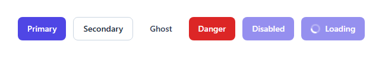
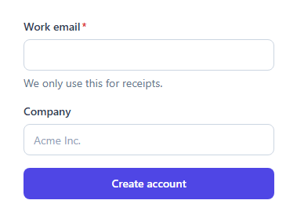
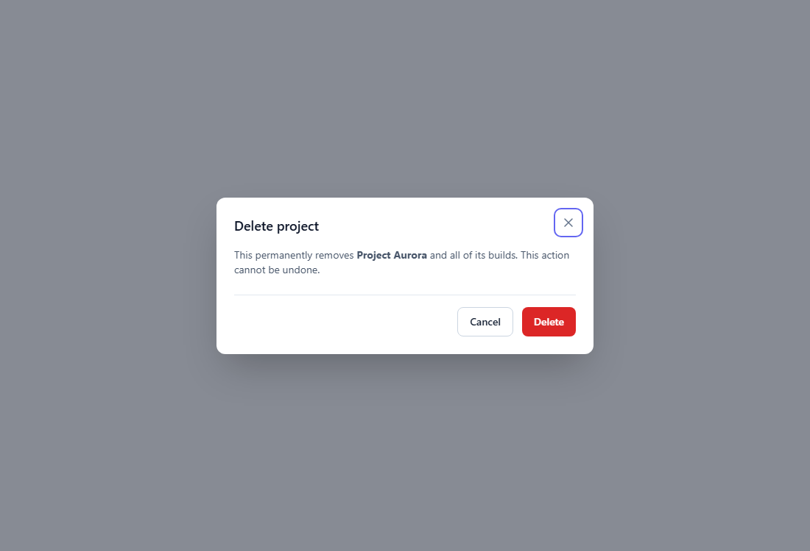
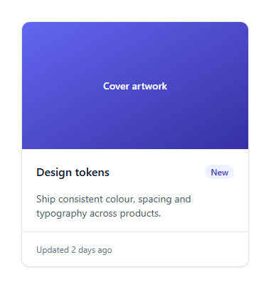
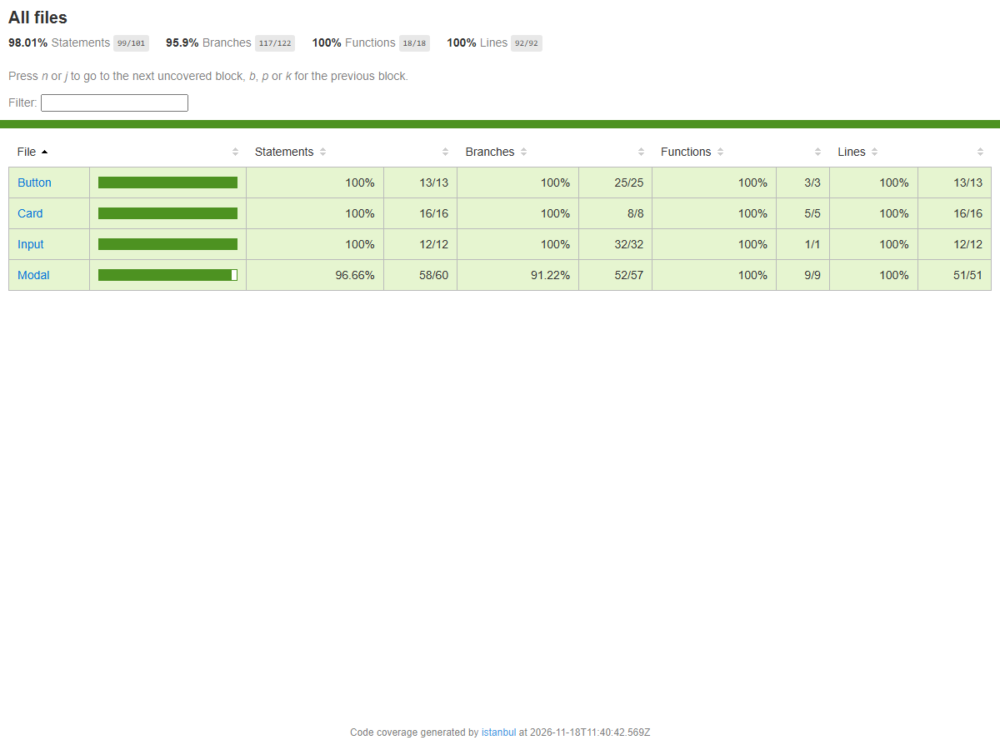

# @elevvo/react-ui

Reusable React component library and design system built with **React 19**, **Tailwind CSS v4**, **Storybook 10**, and **Jest**.

| Component | Description |
| --- | --- |
| `Button` | Primary/secondary/ghost/danger variants, sizes, loading & icon support |
| `Input` | Labeled input with hints, errors, affixes, and a11y wiring |
| `Modal` | Accessible dialog with focus trap, portal, and keyboard handling |
| `Card` | Elevated/outlined/filled compound card with media & footer slots |

## Screenshots

| Button | Input |
| --- | --- |
|  |  |

| Modal | Card |
| --- | --- |
|  |  |

## Quick Start

```bash
npm install @elevvo/react-ui
```

```jsx
import { Button, Input, Modal, Card } from '@elevvo/react-ui';
import '@elevvo/react-ui/styles.css';

export function Example() {
  return (
    <Card>
      <Card.Header>Stay in the loop</Card.Header>
      <Card.Body>
        <Input label="Email" type="email" hint="We never share it." required />
      </Card.Body>
      <Card.Footer>
        <Button variant="primary">Subscribe</Button>
      </Card.Footer>
    </Card>
  );
}
```

> `react`/`react-dom` (≥18) are peer dependencies. Import `styles.css` once to include compiled utilities and design tokens.

## Scripts

| Command | Description |
| --- | --- |
| `npm test` | Run unit tests |
| `npm run test:coverage` | Tests with coverage report |
| `npm run storybook` | Start Storybook at `http://localhost:6006` |
| `npm run build-storybook` | Build static Storybook site |
| `npm run build` | Build library bundle (ESM + CJS + CSS) |

## Test & Build Results (Proof)

**Test run (`npm run test:coverage`)** — 4 suites, **47/47 tests passed**, 98.01% statements / 95.90% branches / 100% functions & lines.



- Raw logs: [`docs/results/test-results.txt`](docs/results/test-results.txt) · [`docs/results/build-results.txt`](docs/results/build-results.txt)

**Build (`npm run build`)** — completed successfully:

| Artifact | Size | Gzip |
| --- | ---: | ---: |
| `dist/index.mjs` | 11.06 kB | 3.37 kB |
| `dist/index.cjs` | 7.86 kB | 2.90 kB |
| `dist/styles.css` | minified (Tailwind v4) | — |

## Project Structure

```text
src/
  components/   # Button, Input, Modal, Card (+ stories & tests)
  styles/       # Tailwind v4 @theme design tokens
  utils/        # cx, focus helpers
  docs/         # Storybook MDX docs
.storybook/     # Storybook config (docs + a11y)
docs/images/    # README screenshots & coverage proof
docs/results/   # Raw test/build output logs
```
